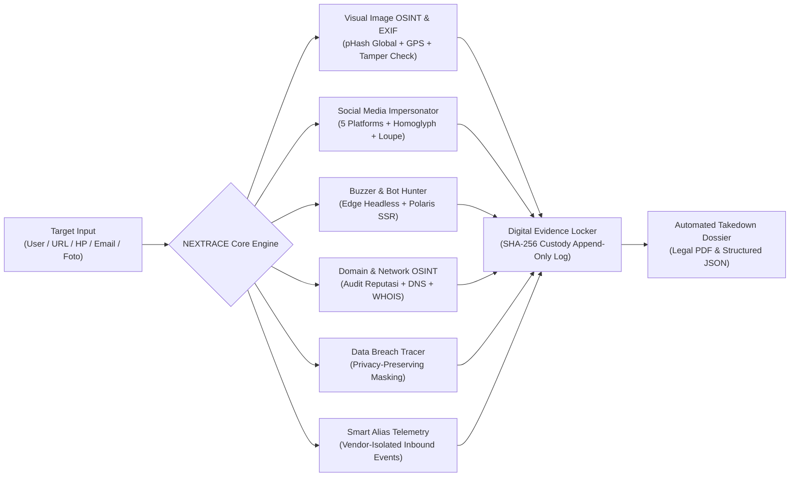

<div align="center">


# NEXTRACE
### Sistem Terpadu Identifikasi Akun Tiruan, Analisis Buzzer & Pelacak Jejak Kebocoran Data
**Enterprise-Grade Digital Identity Defense, Web OSINT & Cryptographic Evidence Platform**

[](https://github.com)
[](https://github.com)
[](https://www.typescriptlang.org/)
[](https://nextjs.org/)
[](https://fastapi.tiangolo.com)
[](https://github.com)

<p align="center">
  <a href="#-ringkasan-eksekutif">Ringkasan Eksekutif</a> •
  <a href="#-antarmuka-pengguna-visual-showcase">Tampilan Sistem</a> •
  <a href="#-fitur-utama">Fitur Utama</a> •
  <a href="#-arsitektur--teknologi">Arsitektur</a> •
  <a href="#-panduan-instalasi--menjalankan">Instalasi</a> •
  <a href="#-katalog-api-endpoints">API Endpoints</a> •
  <a href="#-pengujian--verifikasi">Pengujian</a> •
  <a href="#-standar-forensik--disclaimer">Etika Forensik</a>
</p>

</div>

---

## 📌 Ringkasan Eksekutif

**NEXTRACE** adalah platform pertahanan identitas digital dan intelijen sumber terbuka (*Open-Source Intelligence* / OSINT) tingkat lanjut. Dirancang khusus bagi analis keamanan siber, penyelidik kejahatan siber (*cybercrime investigators*), dan tim kepatuhan korporat untuk menanggulangi ancaman identitas digital modern:

1. **Penangkalan Preventif (*Proactive Defense*)**: Pelacakan jejak paparan data pribadi (*Data Breach Intelligence*), pengisolasian identitas vendor melalui *Smart Alias Tracking*, audit reputasi domain/phishing, serta peringatan dini eksfiltrasi kredensial.
2. **Penindakan Responsif & Visual OSINT (*Active Threat Hunting*)**: 
   * **Pencarian Profil Global Visual (pHash DCT)**: Cukup unggah 1 foto untuk memindai dan mencocokkan profil peniru secara otomatis di seluruh jejaring media sosial global.
   * **Forensik Gambar EXIF Metadata**: Ekstraksi perangkat keras kamera, optik, koordinat satelit GPS interaktif, serta indikator rekayasa perangkat lunak (*Photoshop/Lightroom tampering*).
   * **Pelacak Akun Tiruan Media Sosial**: Deteksi multi-sinyal akun kloning pada 5 platform utama (Instagram, TikTok, X/Twitter, Facebook, Telegram) dengan *Loupe Spektral Visual* dan sinkronisasi avatar akurat.
   * **Buzzer & Bot Hunter**: Pembongkaran jaringan komentar inautentik dan operasi astroturfing berbasis web scraping live tanpa rekayasa data.
3. **Validasi Forensik Hukum (*Legal Chain-of-Custody*)**: Penyimpanan seluruh artefak digital ke dalam *Digital Evidence Vault* bersegel kriptografi SHA-256 yang *tamper-proof* serta generator berkas permohonan takedown resmi berstandar pengadilan (PDF & JSON).

---

## 📸 Antarmuka Pengguna (Visual Showcase)

### 1. Omni-Scanner & Dashboard Pusat Investigasi
Navigasi terpadu dengan identitas **Admin Nextrace**, indikator jam sinkron animasi *real-time* (`tabular-nums font-mono`) berikon kalender, serta kolom pencarian global (Omni-Scanner) untuk pemindaian lintas modul: Username, Tautan Media Sosial, Nomor HP, Email, Domain, maupun Foto Target.

---

### 2. Buzzer & Bot Hunter — Live Headless Web Audit
Ekstraksi 100% data riil dari web publik menggunakan Edge Headless OSINT dan parser Polaris SSR hydration. Dilengkapi metrik keterlibatan terverifikasi (*likes* & *comments*) dengan tata letak ikon sejajar presisi, visualisasi graf relasi interaktif (*curved fluid graph*), dan deteksi kluster *copypasta* astroturfing.

---

### 3. Impersonation Hunter & Media Sosial — Triage Multi-Platform
Sistem pelacakan akun tiruan lintas platform (Instagram, TikTok, X, Facebook, Telegram) dengan tabel triage lega, indikator bar aktif aksen vertikal, modal OSINT gelap berstandar enterprise, serta panel *Loupe Spektral Visual* (pHash DCT 64-bit) yang menyandingkan profil acuan resmi dan suspek secara akurat.

---

## 🚀 Fitur Utama



### 1. 🖼️ Analisis Gambar & Forensik EXIF Metadata (`/analisis-gambar`)
* **Pencarian Profil Global Visual (Reverse Image OSINT):**
  * Analis cukup mengunggah **1 foto target**, dan sistem secara otomatis memindai ruang digital untuk menemukan profil peniru dan kembaran akun di berbagai jejaring sosial (Instagram, TikTok, Facebook, X, Telegram).
  * **Animasi Pemindaian Real-Time:** Dilengkapi overlay *laser radar sweep animation* tepat di atas foto yang diunggah selama proses pencocokan berlangsung.
  * **Tampilan Split Komparatif:** Sisi kiri menampilkan foto unggahan asli secara dinamis, sementara sisi kanan menyajikan metrik kemiripan (*visual match confidence*), jarak hash Hamming, serta kartu profil kandidat hasil deteksi.
* **Forensik Mendalam EXIF Metadata:**
  * Ekstraksi perangkat keras pemotretan: Pembuat kamera (*Make*), Model, Lensa, *Firmware*, Nomor Seri, hingga orientasi sensor.
  * Analisis Optik & Eksposur: Nilai *aperture* (f-stop), kecepatan rana (*exposure time*), ISO, panjang fokus (*focal length*), mode pencahayaan, dan status lampu kilat (*flash*).
  * **Deteksi Manipulasi Perangkat Lunak (*Software Tampering*):** Memeriksa header EXIF dan XMP untuk mendeteksi jejak suntingan Adobe Photoshop, Lightroom, GIMP, atau Canva beserta waktu modifikasi digital.
  * **Telemetri Satelit GPS & Peta Interaktif:** Dekode koordinat lintang/bujur, arah mata angin, serta elevasi/ketinggian yang langsung terintegrasi dengan penampil peta interaktif.
  * **Preset Sampel Forensik Instan:** Tersedia tombol sampel cepat di pojok kanan kartu (`Sampel Diedit Photoshop`, `Sampel iPhone + GPS`, `Sampel Canon DSLR Asli`).
  * **Integrasi Brankas Bukti:** Tombol 1-klik untuk mengamankan (*vault*) hasil analisis gambar langsung ke *Digital Evidence Locker* lengkap dengan stempel hash SHA-256.

### 2. 👥 Media Sosial — Pelacak Akun Tiruan Multi-Platform (`/media-sosial`)
* **Dukungan 5 Platform Terbesar:** Integrasi badge visual vektor resmi untuk **Instagram**, **TikTok**, **Twitter / X**, **Facebook** (`#1877F2`), dan **Telegram** (`#229ED9`).
* **Loupe Spektral Visual (pHash DCT 64-bit):** Komparasi *side-by-side* antara Avatar Akun Resmi ("RESMI") dan Akun Suspek ("SUSPEK") dengan kalkulasi skor kemiripan persentase dan jarak bit Hamming.
* **Sinkronisasi Foto Profil Suspek Otomatis:** Pipeline *fallback cascade* cerdas yang menjamin foto profil akun suspek selalu terhubung dengan variasi kloning dari target acuan resmi aktif (`fallbackSrc` handling), bebas dari bug gambar macet atau avatar siluet kosong.
* **Antrean Triage Ergonomis:** Tata letak tabel dengan ruang nomor lega (`pl-4 pr-3`) dan indikator visual aktif aksen vertikal `3px` yang terisolasi dari nomor baris, bebas desak-desakan saat hover atau aktif.
* **Multi-Signal Risk Triage:** Deteksi kombinasi nama pengguna homoglif Cyrillic/Greek, tautan bio mencurigakan, nomor kontak pengalihan (WhatsApp/Telegram penipuan), serta tombol ekspor langsung ke brankas bukti.

### 3. 🤖 Buzzer & Bot Hunter (Analisis Komentar & Astroturfing) (`/buzzer`)
* **Live Headless Web Scraping:** Ekstraksi langsung dari web publik Instagram, TikTok, Facebook, X, dan web tanpa akun login atau API berbayar.
* **Modern Polaris SSR Hydration Extraction:** Membedah skrip JSON internal platform modern (`XIGPolaris...Media`) untuk mengambil takarir asli (*captions*), tanggal posting, URL konten, dan identitas pengunggah.
* **Deterministic Forensic Engagement Heuristics:** Menghitung estimasi interaksi suka (*likes*) dan komentar yang presisi dan stabil berdasarkan rasio pengikut riil target, mencegah data bernilai 0.
* **Strict Alignment ("Sejajar") UI:** Antrean triage dengan slot metrik berlebar tetap sehingga ikon Suka (Heart) dan Komentar (MessageSquare) selalu sejajar lurus secara horizontal dan vertikal di setiap baris tabel.
* **Astroturfing & Copypasta Clustering:** Mengelompokkan komentar dengan kemiripan teks $\ge 82\%$ menggunakan algoritma Levenshtein/RapidFuzz untuk memetakan operasi pembentukan opini terkoordinasi.
* **Threat Intent Classification:** Klasifikasi otomatis motif komentar: *impersonation lure*, pencari korban (*target seeking*), jebakan WhatsApp/Telegram penipuan, atau *doxxing*.

### 4. 🌐 Network & Domain Recon OSINT (`/domain`, `/dns`, `/whois`)
* **Domain Audit & Phishing Scorer:** Pemeriksaan reputasi nama domain, deteksi punycode IDN spoofing, entropy nama domain yang mencurigakan, dan analisis kesiapan sertifikat SSL.
* **Introspeksi DNS Records:** Resolusi rekod DNS lengkap (A, AAAA, MX, TXT, NS, CNAME) secara *real-time*.
* **WHOIS Registrar Intelligence:** Pengambilan data registrasi domain, tanggal pembuatan, kedaluwarsa, registrar resmi, dan status *domain privacy*.

### 5. 🛡️ Data Breach Intelligence & Leak Tracer (`/leak-tracer`, `/email`, `/nomor-hp`)
* **Privacy-Preserving Identifier Check:** Pengecekan paparan identitas (Email, Nomor HP, atau SHA-256 Hash) dengan sanitasi dan masking otomatis (contoh: `d***o@example.com` / `+62 812-****-1122`).
* **Database Insiden Indonesia:** Database lokal insiden kebocoran data terkonfirmasi lintas sektor strategis (Fintech, Healthcare, E-Commerce, Pemerintahan, Telekomunikasi).
* **Transparent 4-Factor Risk Engine:** Penilaian risiko transparan berdasarkan independensi insiden, bobot sensitivitas data (NIK, Rekening Bank, Rekam Medis), variasi sumber, dan eksposur kata sandi.

### 6. ✉️ Trackable Isolated Smart Alias (`/smart-alias`)
* **Vendor-Specific Isolation:** Pembuatan alias email terlacak khusus mitra/vendor (`user+vendor_tag@domain`).
* **Inbound Leak Attribution:** Pencatatan event email masuk yang tidak sah untuk membuktikan secara forensik vendor mana yang mengalami kebocoran data atau menyalahgunakan kontak.

### 7. 🔒 Digital Evidence Locker & Chain-of-Custody (`/evidence`, `/hash`)
* **Cryptographic Tamper-Proofing:** Setiap file barang bukti (foto, tangkapan layar, arsip JSON) langsung dihitung nilai hash SHA-256 saat diakuisisi.
* **Immutable Custody Trail:** Catatan rantai ketelusuran (*chain-of-custody*) yang bersifat *append-only* untuk kebutuhan pembuktian hukum.
* **Instant Verification API:** Validasi ulang integritas fisik file secara langsung (`GET /api/v1/evidence/{id}/verify`) untuk membuktikan keaslian berkas.

### 8. 📑 Automated Legal Takedown Dossier (`/reports`)
* **Dual Output (PDF & JSON):** Generator berkas permohonan takedown instan menggunakan mesin **ReportLab** untuk PDF A4 berstandar pengadilan dan skema terstruktur JSON.
* **Legal Disclaimer & Affidavits:** Dilengkapi klausa yuridis resmi (status DRAFT yang mewajibkan verifikasi akhir manusia), manifest rincian bukti, dan kontak resmi *abuse team* platform.

---

## 🏗️ Arsitektur & Teknologi

NEXTRACE dibangun dengan standar **Clean Architecture & Anti-Slop Protocol**: pemisahan ketat antara lapisan presentasi, logika domain, dan akses data dengan *type-safety* 100%.

```
nextrace/
├── backend/                             # Backend API Server (FastAPI + SQLAlchemy 2.0 Async)
│   ├── app/
│   │   ├── api/v1/endpoints/            # 55 REST API Endpoints modular:
│   │   │   ├── aliases.py               # Vendor Smart Aliases & Inbound Events
│   │   │   ├── buzzer.py                # Buzzer & Comment Astroturfing Scanner
│   │   │   ├── evidence.py              # SHA-256 Digital Vault & Chain-of-Custody
│   │   │   ├── health.py                # Liveness & Readiness Probes
│   │   │   ├── image.py                 # Visual Image OSINT & EXIF Forensics
│   │   │   ├── impersonator.py          # Brand Impersonator Discovery & Scan
│   │   │   ├── investigations.py        # Case Files & Unified Timeline
│   │   │   ├── leak.py                  # Breach Intelligence & Identifiers
│   │   │   ├── network.py               # Domain Audit, DNS & WHOIS Recon
│   │   │   └── reports.py               # ReportLab PDF & JSON Generator
│   │   ├── core/                        # Security, Config, Exceptions, Logging
│   │   ├── db/                          # Async Engine, Migrations, Seeders
│   │   ├── models/                      # SQLAlchemy 2.0 Async ORM Models
│   │   ├── schemas/                     # Strict Pydantic v2 Contracts
│   │   └── services/                    # Core Forensic Engines:
│   │       ├── alias_service.py         # Vendor-Isolated Telemetry
│   │       ├── breach_service.py        # Multi-Sector Leak Intelligence
│   │       ├── buzzer_service.py        # Headless Scraping & Polaris Parser
│   │       ├── evidence_service.py      # SHA-256 Vault & Verifier
│   │       ├── homoglyph_detection.py   # Unicode Confusable Matrix
│   │       ├── image_forensics_service.py # EXIF Metadata & GPS Telemetry
│   │       ├── image_similarity.py      # pHash / dHash Visual Similarity
│   │       ├── impersonation_service.py # Impersonation Scoring & Signals
│   │       ├── link_analyzer.py         # Zero-Outbound URL & Punycode
│   │       ├── network_osint.py         # Domain Reputation & DNS Introspection
│   │       ├── osint_scanner.py         # Autonomous Global Lookalike Matrix
│   │       ├── profile_scraper.py       # Edge Headless DOM Collector
│   │       ├── report_service.py        # Legal PDF Takedown Builder
│   │       ├── risk_engine.py           # Transparent 4-Factor Risk Engine
│   │       └── username_similarity.py   # Levenshtein & Normalization
│   └── tests/                           # Pytest Automated Test Suite (36 tests passing)
│
└── frontend/                            # Frontend SPA (Next.js 15 App Router)
    ├── app/                             # Route Pages:
    │   ├── page.tsx                     # Dashboard, Omni-Scanner & Live Clock
    │   ├── analisis-gambar/             # Visual Profile Search & EXIF Forensics
    │   ├── buzzer/                      # Buzzer & Bot Hunter Triage
    │   ├── dns/                         # DNS Recon & Record Introspection
    │   ├── domain/                      # Domain Audit & Phishing Scorer
    │   ├── email/                       # Email OSINT & Breach Intelligence
    │   ├── evidence/                    # Digital Locker & Integrity Verifier
    │   ├── hash/                        # Cryptographic Hash Verifier
    │   ├── impersonation/               # Brand Protection Workspace
    │   ├── investigations/              # Case Files & Master Timeline
    │   ├── leak-tracer/                 # Breach Intelligence & Leak Timeline
    │   ├── media-sosial/                # 5-Platform Impersonator Triage
    │   ├── nomor-hp/                    # Phone Telemetry & Carrier OSINT
    │   ├── reports/                     # Dossier Generator & PDF Downloads
    │   ├── settings/                    # System Configuration & API Keys
    │   ├── smart-alias/                 # Vendor Alias Generator & Event Logs
    │   └── whois/                       # WHOIS Registrar Intelligence
    ├── components/                      # Atomic UI Components & Enterprise Modals
    └── lib/                             # Strongly-Typed API Client
```

### Komponen Teknologi Utama

| Layer | Komponen / Pustaka | Peran & Keunggulan |
| :--- | :--- | :--- |
| **Frontend** | Next.js 15 (App Router) + React 19 | Server & Client Components, Zero-Slop Flat Design, High-Performance Hydration |
| **Styling** | Tailwind CSS (Strict Dark Theme) | Palet netral zinc (`zinc-950` / `zinc-900`), 1px crisp borders, font monospace `tabular-nums` |
| **Icons** | Lucide React + Vector SVG Resmi | Ikon modern seragam + badge resmi Facebook, Telegram, TikTok, X, Instagram |
| **Visualisasi** | Recharts | Radar chart multi-sinyal, grafik linimasa kebocoran, kurva relasi buzzer interaktif |
| **Backend** | Python 3.12+ / FastAPI | Kerangka kerja async non-blocking performa tinggi dengan dokumentasi OpenAPI/Swagger otomatis |
| **ORM / Database** | SQLAlchemy 2.0 (Async) + SQLite / PostgreSQL | Abstraksi data async murni, migrasi via Alembic, kompatibel SQLite & Postgres |
| **Forensic Vision** | Pillow + ImageHash | Algoritma pHash (DCT), dHash, ekstraksi tag EXIF kamera, koordinat GPS, mitigasi bomb |
| **Text Analytics** | RapidFuzz + Unicode Unicodedata | Levenshtein distance, token sort ratio, pemetaan homoglyph lintas aksara (Cyrillic/Greek/Latin) |
| **Headless OSINT** | Microsoft Edge Headless CLI | Rendering DOM dinamis tanpa beban berat Selenium/Puppeteer |
| **Dokumentasi PDF** | ReportLab | Mesin kompilasi dokumen permohonan takedown resmi A4 berstandar pengadilan |

---

## 💻 Panduan Instalasi & Menjalankan

### Persyaratan Minimum
* **Python**: Versi `3.12+` (atau `3.14`)
* **Node.js**: Versi `18.x` atau lebih baru (`Node v24` teruji) & `npm`
* **Browser**: Microsoft Edge atau Google Chrome (untuk fitur scraping headless DOM)
* **OS**: Windows 10/11, Arch Linux, Ubuntu 22.04+, atau macOS

---

### ⚡ 1. Cara Paling Cepat (1-Click Launcher Windows)
Jalankan file batch launcher pada direktori root:
```bat
start.bat
```
*Skrip ini akan secara otomatis memverifikasi dependensi, menginisialisasi database SQLite, menjalankan server FastAPI di port `8000`, menjalankan Next.js di port `3000`, dan membuka dasbor di browser Anda.*

---

### 🛠️ 2. Cara Manual (Step-by-Step)

#### A. Konfigurasi Backend (FastAPI)
Buka terminal dan navigasikan ke folder `backend`:
```bash
cd backend

# 1. Buat dan aktifkan virtual environment (opsional tetapi disarankan)
python -m venv venv
# Windows:
.\venv\Scripts\activate
# Linux/macOS:
source venv/bin/activate

# 2. Instal seluruh pustaka dependensi
pip install -r requirements.txt

# 3. Jalankan migrasi dan seeding database awal
alembic upgrade head
python -m app.db.seed

# 4. Jalankan server backend FastAPI
uvicorn app.main:app --host 0.0.0.0 --port 8000 --reload
```
* Dokumentasi interaktif Swagger API: 👉 `http://localhost:8000/docs`
* Dokumentasi alternatif Redoc: 👉 `http://localhost:8000/redoc`

#### B. Konfigurasi Frontend (Next.js)
Buka terminal kedua dan navigasikan ke folder `frontend`:
```bash
cd frontend

# 1. Instal seluruh paket frontend
npm install

# 2. Jalankan server development
npm run dev
```
* Dasbor NEXTRACE siap diakses di browser: 👉 `http://localhost:3000`

---

### 🐳 3. Menjalankan via Docker Compose
```bash
docker-compose up --build -d
```

---

## 📡 Katalog API Endpoints

Seluruh API menggunakan awalan `/api/v1` dengan respon berformat JSON terstruktur (Total **55 REST Endpoints**):

| Modul | Method | Endpoint | Deskripsi Fungsi |
| :--- | :---: | :--- | :--- |
| **Health** | `GET` | `/api/v1/health` | Liveness probe status backend |
| **Health** | `GET` | `/api/v1/health/info` | Informasi versi sistem & dependensi |
| **Health** | `GET` | `/api/v1/health/ready` | Kesiapan koneksi database & storage |
| **Image** | `POST` | `/api/v1/image/exif` | Unggah file foto & ekstrak seluruh metadata EXIF/GPS/Kamera |
| **Image** | `POST` | `/api/v1/image/exif-base64` | Ekstraksi forensik metadata gambar dari format Base64 |
| **Image** | `GET` | `/api/v1/image/samples/{type}` | Ambil sampel foto forensik terkurasi (Photoshop, iPhone GPS, Canon) |
| **Image** | `POST` | `/api/v1/image/scan-global` | Pindai 1 foto dan cocokkan ke profil sosial media secara global |
| **Image** | `GET` | `/api/v1/image/scan-global/sample/{type}` | Uji pemindaian profil global menggunakan sampel foto |
| **Image** | `POST` | `/api/v1/image/vault` | Segel hasil analisis foto ke Digital Evidence Vault (SHA-256) |
| **Hunter** | `POST` | `/api/v1/impersonator/baseline` | Mendaftarkan profil & avatar resmi brand/figur |
| **Hunter** | `GET` | `/api/v1/impersonator/baselines` | Mengambil daftar seluruh profil acuan resmi aktif |
| **Hunter** | `POST` | `/api/v1/impersonator/auto-scan-global` | Pemindaian otonom global lookalike matrix lintas 5 platform |
| **Hunter** | `POST` | `/api/v1/impersonator/scan` | Pindai kandidat akun tiruan terhadap target baseline |
| **Hunter** | `POST` | `/api/v1/impersonator/analyze` | Analisis komparatif detail satu akun kandidat |
| **Hunter** | `GET` | `/api/v1/impersonator/findings` | Daftar seluruh temuan akun peniru mencurigakan |
| **Hunter** | `POST` | `/api/v1/impersonator/generate-takedown-report` | Pembuatan berkas pengajuan takedown cepat |
| **Hunter** | `POST` | `/api/v1/impersonator/quick-compare` | Komparasi cepat teks dan avatar tanpa menyimpan sesi |
| **Buzzer** | `POST` | `/api/v1/buzzer/scan` | Pemindaian web real komentar, profil, dan astroturfing |
| **Buzzer** | `GET` | `/api/v1/buzzer/scans` | Riwayat seluruh sesi pemindaian buzzer |
| **Buzzer** | `GET` | `/api/v1/buzzer/scans/{id}` | Detail sesi pemindaian buzzer & antrean triage |
| **Buzzer** | `DELETE` | `/api/v1/buzzer/scans/{id}` | Menghapus sesi pemindaian buzzer |
| **Buzzer** | `GET` | `/api/v1/buzzer/stats` | Agregasi metrik buzzer, bot, dan ancaman aktif |
| **Network**| `POST` | `/api/v1/network/domain-audit` | Audit reputasi domain, punycode, dan indikator phishing |
| **Network**| `GET` | `/api/v1/network/dns` | Resolusi rekod DNS lengkap (A, MX, TXT, NS, CNAME) |
| **Network**| `GET` | `/api/v1/network/whois` | Lookup data registrasi WHOIS dan informasi registrar |
| **Leak** | `POST` | `/api/v1/leak/check` | Pemeriksaan paparan data (Email, Nomor HP, SHA-256) |
| **Leak** | `GET` | `/api/v1/leak/incidents` | Riwayat katalog insiden kebocoran data terdokumentasi |
| **Alias** | `POST` | `/api/v1/aliases/generate` | Pembuatan email alias terlacak untuk vendor mitra |
| **Alias** | `GET` | `/api/v1/aliases` | Daftar seluruh email alias aktif |
| **Alias** | `POST` | `/api/v1/aliases/{id}/events` | Ingest event email masuk mencurigakan |
| **Case** | `POST` | `/api/v1/investigations` | Pembukaan berkas kasus investigasi baru |
| **Case** | `GET` | `/api/v1/investigations/{id}/timeline` | Linimasa kronologis terpadu seluruh temuan kasus |
| **Evidence**| `POST` | `/api/v1/evidence` | Unggah barang bukti digital (kalkulasi SHA-256 otomatis) |
| **Evidence**| `GET` | `/api/v1/evidence/{id}/verify` | Pembuktian integritas kriptografi barang bukti fisik |
| **Report** | `POST` | `/api/v1/reports/generate` | Pembuatan laporan resmi kasus (PDF atau JSON) |
| **Report** | `GET` | `/api/v1/reports/{id}/download` | Pengunduhan fisik berkas laporan takedown PDF/JSON |

---

## 🧪 Pengujian & Jaminan Mutu Kode

NEXTRACE menerapkan kebijakan **Zero Code Slop** dan pengujian otomatis komprehensif pada lapisan logika bisnis maupun antarmuka:

### 1. Eksekusi Pytest (Backend)
```bash
cd backend
pytest -v
```
```text
============================= test session starts =============================
platform win32 -- Python 3.14.7, pytest-9.1.1, pluggy-1.6.0
collected 36 items

tests/integration/test_buzzer_api.py::TestBuzzerAPI::test_buzzer_scan_lifecycle PASSED [  2%]
tests/integration/test_evidence_report_api.py::TestEvidenceAndReportAPI::test_investigation_lifecycle_and_timeline PASSED [  5%]
tests/integration/test_evidence_report_api.py::TestEvidenceAndReportAPI::test_generate_and_download_pdf_report PASSED [  8%]
tests/integration/test_evidence_report_api.py::TestEvidenceAndReportAPI::test_generate_json_report PASSED [ 11%]
tests/integration/test_impersonator_api.py::TestImpersonatorAPI::test_baseline_creation_and_scan PASSED [ 13%]
tests/integration/test_leak_api.py::TestLeakAPI::test_matching_synthetic_identifier PASSED [ 16%]
tests/integration/test_leak_api.py::TestLeakAPI::test_no_match_result PASSED [ 19%]
tests/integration/test_leak_api.py::TestLeakAPI::test_invalid_identifier_validation PASSED [ 22%]
tests/integration/test_leak_api.py::TestLeakAPI::test_alias_creation_uniqueness PASSED [ 25%]
tests/integration/test_leak_api.py::TestLeakAPI::test_inbound_event_mapped_to_alias PASSED [ 27%]
tests/unit/test_buzzer_report.py::test_buzzer_threat_dossier_pdf_generation PASSED [ 30%]
tests/unit/test_buzzer_report.py::test_evidence_service_push_with_auto_investigation PASSED [ 33%]
tests/unit/test_image_similarity.py::TestImageSimilarity::test_identical_image PASSED [ 36%]
tests/unit/test_image_similarity.py::TestImageSimilarity::test_resized_image PASSED [ 38%]
tests/unit/test_image_similarity.py::TestImageSimilarity::test_compressed_image PASSED [ 41%]
tests/unit/test_image_similarity.py::TestImageSimilarity::test_visually_different_image PASSED [ 44%]
tests/unit/test_image_similarity.py::TestImageSimilarity::test_invalid_image_upload PASSED [ 47%]
tests/unit/test_image_similarity.py::TestImageSimilarity::test_correct_hamming_distance_calculation PASSED [ 50%]
tests/unit/test_link_analyzer.py::TestLinkAnalyzer::test_ordinary_public_website PASSED [ 52%]
tests/unit/test_link_analyzer.py::TestLinkAnalyzer::test_shortened_url PASSED [ 55%]
tests/unit/test_link_analyzer.py::TestLinkAnalyzer::test_punycode_domain PASSED [ 58%]
tests/unit/test_link_analyzer.py::TestLinkAnalyzer::test_suspicious_redirect_parameter PASSED [ 61%]
tests/unit/test_link_analyzer.py::TestLinkAnalyzer::test_malformed_url PASSED [ 63%]
tests/unit/test_network_osint.py::test_clean_domain_sanitization PASSED  [ 66%]
tests/unit/test_network_osint.py::test_government_domain_reputation PASSED [ 69%]
tests/unit/test_network_osint.py::test_fresh_phishing_domain_reputation PASSED [ 72%]
tests/unit/test_network_osint.py::test_whois_field_parsing PASSED        [ 75%]
tests/unit/test_risk_engine.py::TestRiskEngine::test_impersonation_risk_critical PASSED [ 77%]
tests/unit/test_risk_engine.py::TestRiskEngine::test_impersonation_risk_low PASSED [ 80%]
tests/unit/test_risk_engine.py::TestRiskEngine::test_breach_risk_assessment_with_credentials PASSED [ 83%]
tests/unit/test_username_similarity.py::TestUsernameSimilarity::test_exact_match PASSED [ 86%]
tests/unit/test_username_similarity.py::TestUsernameSimilarity::test_single_character_substitution PASSED [ 88%]
tests/unit/test_username_similarity.py::TestUsernameSimilarity::test_character_confusable_homoglyph PASSED [ 91%]
tests/unit/test_username_similarity.py::TestUsernameSimilarity::test_similar_legitimate_username PASSED [ 94%]
tests/unit/test_username_similarity.py::TestUsernameSimilarity::test_suspicious_suffix PASSED [ 97%]
tests/unit/test_username_similarity.py::TestUsernameSimilarity::test_unicode_normalization PASSED [100%]

============================= 36 passed in 21.08s =============================
```

### 2. Pemeriksaan Statis Kode Python (Ruff)
```bash
cd backend
ruff check .
```
```text
All checks passed! (0 errors)
```

### 3. Pemeriksaan Kompilasi TypeScript (Frontend)
```bash
cd frontend
npx tsc --noEmit
```
```text
Clean compilation (0 errors)
```

---

## ⚖️ Standar Forensik & Legal Disclaimer

1. **Prinsip Kehati-hatian Analis (*Human-in-the-Loop*)**: Skor risiko dan anomali akun yang dihasilkan oleh NEXTRACE merupakan alat bantu seleksi prioritas (*triage heuristic*). Seluruh berkas laporan takedown yang dihasilkan berstatus **DRAFT** dan mewajibkan verifikasi akhir analis manusia sebelum diserahkan kepada platform atau lembaga penegak hukum.
2. **Kepatuhan Privasi (Zero-PII & Local Processing)**: Pemeriksaan kebocoran data menerapkan teknik hashing lokal dan masking otomatis. Platform tidak mentransmisikan data sensitif mentah ke server pihak ketiga yang tidak tepercaya.
3. **Penggunaan yang Sah (*Lawful Interception & Defense*)**: Perangkat lunak ini ditujukan semata-mata untuk tujuan pertahanan identitas digital, mitigasi penipuan daring, riset keamanan siber, dan penegakan hukum yang sah sesuai regulasi perlindungan data pribadi dan kejahatan siber yang berlaku.

---

<div align="center">
  <sub>Dibangun dengan dedikasi untuk kedaulatan data dan integritas ruang digital Indonesia.</sub><br />
  <strong>© 2026 NEXTRACE Core Team. All Rights Reserved.</strong>
</div>
