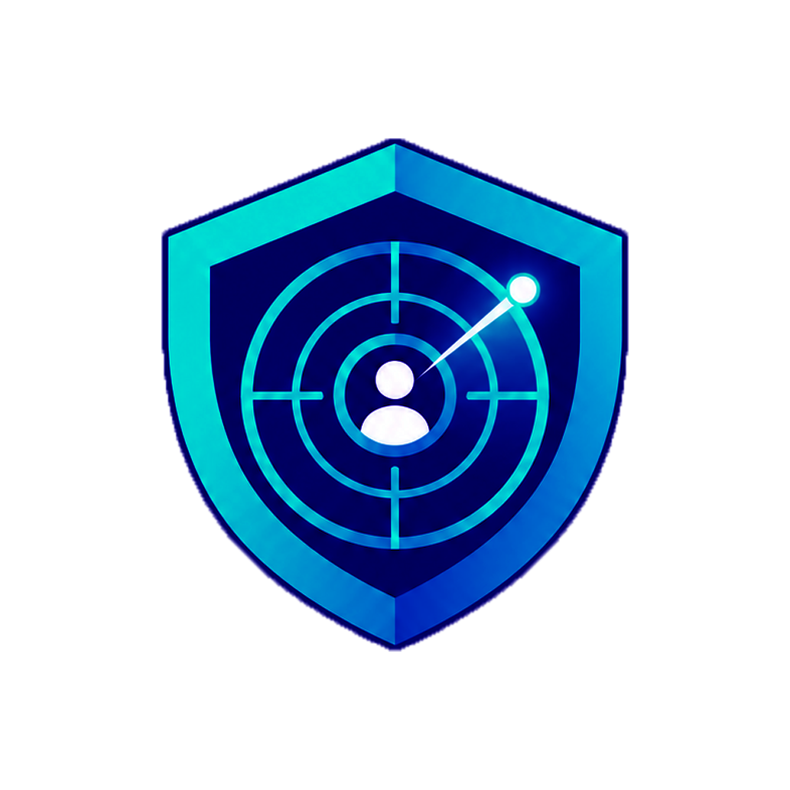
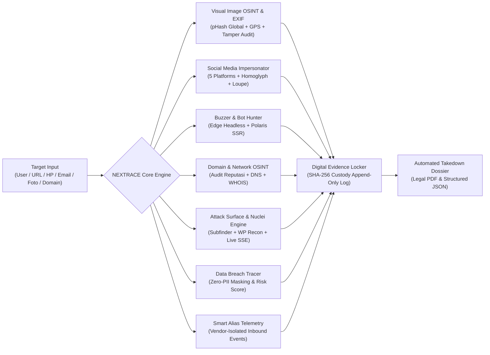

<div align="center">



# NEXTRACE
### Platform Pertahanan Identitas Digital, Web OSINT & Forensik Bukti Kriptografis
**Enterprise-Grade Digital Identity Defense, Attack Surface Intelligence & Cryptographic Evidence Vault**

[](https://nextjs.org/)
[](https://fastapi.tiangolo.com)
[](https://www.typescriptlang.org/)
[](https://python.org)
[](https://github.com)

<p align="center">
  <a href="#-ringkasan-eksekutif">Ringkasan Eksekutif</a> •
  <a href="#-fitur-utama">Fitur Utama</a> •
  <a href="#-arsitektur--teknologi">Arsitektur</a> •
  <a href="#-panduan-instalasi">Instalasi</a> •
  <a href="#-katalog-api-endpoints">Katalog API</a> •
  <a href="#-standar-forensik--legal-disclaimer">Etika Forensik</a>
</p>

</div>

---

## 📌 Ringkasan Eksekutif

**NEXTRACE** adalah platform investigasi identitas digital dan *Open-Source Intelligence* (OSINT) tingkat enterprise. Dirancang untuk analis keamanan siber, penyelidik tindak pidana siber, dan tim kepatuhan korporat guna mendeteksi ancaman akun tiruan (*impersonation*), membongkar operasi manipulasi opini publik (*astroturfing buzzer*), memetakan celah serangan eksternal (*attack surface*), serta melacak kebocoran data (*data breach*) secara sah dan terstandarisasi.

### Pilar Utama Kapabilitas

1. **Investigasi Visual & Forensik Metadata (Visual OSINT)**
   Pencocokan profil peniru di seluruh jejaring sosial global berbasis algoritma *perceptual hash* (pHash DCT 64-bit) dan audit forensik metadata EXIF citra (perangkat kamera, lensa, telemetri satelit GPS, serta indikator rekayasa digital Photoshop/Lightroom).
2. **Pelacak Akun Tiruan Multi-Platform (Impersonator Hunter)**
   Deteksi dini akun kloning pada 5 platform utama (Instagram, TikTok, X/Twitter, Facebook, Telegram) dengan analisis leksikal homoglyph Unicode, tautan bio, dan komparasi spektral avatar resmi vs suspek.
3. **Pembongkaran Operasi Buzzer & Bot (Headless Scraping & Astroturfing)**
   Ekstraksi data publik real-time menggunakan arsitektur headless browser dan parser Polaris SSR tanpa bergantung pada API berbayar. Dilengkapi pengelompokan teks *copypasta* dan pemetaan graf relasi interaktif.
4. **Attack Surface Management & Nuclei Engine v3.11**
   Enumerasi subdomain pasif melalui Subfinder CLI dan Certificate Transparency logs (`crt.sh`), deteksi dini kerentanan *dangling CNAME takeover*, audit kerentanan terarah ProjectDiscovery Nuclei, serta modul khusus *WordPress Security Recon* dengan streaming log terminal interaktif via Server-Sent Events (SSE).
5. **Integritas Rantai Bukti Hukum (Digital Evidence Vault)**
   Penyegelan seluruh artefak digital menggunakan stempel kriptografi SHA-256 (*tamper-proof chain-of-custody*) dan generator otomatis berkas permohonan *takedown* resmi berstandar hukum (PDF & JSON).

---

## 🚀 Fitur Utama



### 1. 🖼️ Analisis Gambar & Forensik EXIF Metadata (`/analisis-gambar`)
* **Pencarian Profil Global Visual:** Cukup unggah 1 foto untuk memindai ruang digital dan mencocokkan profil peniru di berbagai media sosial secara otonom.
* **Forensik Kamera & Optik:** Ekstraksi data kamera (Make, Model, Serial Number, Lensa, Exposure, Aperture, ISO).
* **Deteksi Rekayasa Digital (*Software Tampering*):** Audit header EXIF/XMP untuk mendeteksi jejak suntingan software grafis (Adobe Photoshop, Lightroom, Canva, GIMP).
* **Telemetri Satelit GPS:** Dekode koordinat lintang/bujur, arah mata angin, elevasi, dan tautan peta interaktif.
* **Segel Kriptografis 1-Klik:** Pengamanan instan temuan gambar ke dalam Evidence Vault berstempel SHA-256.

### 2. 👥 Media Sosial — Pelacak Akun Tiruan Multi-Platform (`/media-sosial`)
* **Dukungan 5 Platform Terbesar:** Integrasi resmi untuk Instagram, TikTok, X (Twitter), Facebook, dan Telegram.
* **Loupe Spektral Visual (pHash DCT 64-bit):** Komparasi *side-by-side* avatar resmi vs suspek dengan kalkulasi skor kemiripan persentase dan jarak bit Hamming.
* **Multi-Signal Risk Triage:** Deteksi kombinasi karakter homoglif Cyrillic/Greek, tautan bio mencurigakan, dan kontak penipuan.

### 3. 🤖 Buzzer & Bot Hunter (Analisis Astroturfing) (`/buzzer`)
* **Live Headless Web Scraping:** Ekstraksi data riil web publik Instagram, TikTok, Facebook, dan X tanpa akun login atau API berbayar.
* **Modern Polaris SSR Hydration:** Ekstraksi skrip JSON internal platform untuk memperoleh teks takarir asli, timestamp, dan identitas pengunggah.
* **Astroturfing & Copypasta Clustering:** Pengelompokan komentar terkoordinasi dengan kemiripan teks $\ge 82\%$ berbasis algoritma Levenshtein/RapidFuzz.
* **Visualisasi Topologi Jaringan:** Graf kurva relasi dinamis yang memetakan kluster akun buzzer, sentimen, dan intent ancaman.

### 4. 🛡️ Attack Surface Management & Nuclei Engine (`/domain`)
* **Dual-Engine Subdomain Discovery:** Integrasi Subfinder CLI v2.17.0 dan Certificate Transparency Logs (`crt.sh`) untuk memetakan aset eksternal secara non-intrusif.
* **Dangling CNAME Takeover Detection:** Deteksi rekod DNS usang yang mengarah ke penyedia cloud (GitHub, AWS S3, Heroku, Azure, Vercel) yang rentan disandera.
* **Targeted Nuclei Vulnerability Scanner (v3.11.1):** Pemindaian berbasis ribuan template resmi ProjectDiscovery dengan filter tingkat keparahan (*Critical, High, Medium, Low*), kode reproduksi `curl PoC`, dan saran remediasi.
* **WordPress Security Recon (Non-Destruktif):** Audit otomatis rute sensitif:
  * `/wp-json/wp/v2/users` (kebocoran enumerasi username publik).
  * `/xmlrpc.php` (antarmuka brute-force massal & DDoS amplification).
  * `/readme.html` (pengungkapan versi rilis inti untuk pemetaan CVE).
  * `/wp-content/debug.log` (eksposur stack trace PHP & query internal).
  * Backup konfigurasi database (`wp-config.php.bak`, `wp-config.php.old`, `.swp`).
* **Live SSE Terminal Log Streaming:** Konsol monospace interaktif realtime via Server-Sent Events (`text/event-stream`) dengan pewarnaan level log, penemuan live findings, auto-scroll, dan kontrol pembatalan.

### 5. 🌐 Network & Domain Recon OSINT (`/domain`, `/dns`, `/whois`)
* **Audit Reputasi Domain & Phishing:** Deteksi punycode IDN spoofing, entropi nama domain acak, dan validitas sertifikat SSL.
* **Introspeksi Rekod DNS & WHOIS:** Resolusi rekod DNS lengkap (A, AAAA, MX, TXT, NS, CNAME) dan kepemilikan registrar WHOIS.

### 6. 🔍 Data Breach Intelligence & Leak Tracer (`/leak-tracer`, `/email`, `/nomor-hp`)
* **Zero-PII Privacy-Preserving Check:** Pengecekan paparan identitas (Email, Nomor HP, atau SHA-256 Hash) dengan sanitasi dan masking otomatis (`d***o@example.com`).
* **Katalog Insiden Nasional:** Basis data insiden kebocoran data lintas sektor strategis di Indonesia.
* **4-Factor Risk Engine:** Pembobotan risiko objektif berdasarkan independensi insiden, jenis data sensitif (NIK, Rekening, Medis), dan variasi sumber.

### 7. ✉️ Trackable Isolated Smart Alias (`/smart-alias`)
* **Vendor-Specific Isolation:** Pembuatan alias email terlacak khusus mitra/vendor (`user+vendor_tag@domain`).
* **Inbound Leak Attribution:** Pencatatan event email masuk yang tidak sah untuk membuktikan secara forensik vendor mana yang membocorkan data.

### 8. 🔒 Digital Evidence Vault & Chain-of-Custody (`/evidence`, `/hash`)
* **Integritas Bukti Kriptografis:** Perhitungan nilai hash SHA-256 otomatis pada setiap barang bukti (gambar, dokumen, arsip JSON) saat diakuisisi.
* **Jejak Audit Immutable:** Rantai ketelusuran (*chain-of-custody*) bersifat *append-only* untuk kebutuhan hukum dan regulasi.
* **Verifikasi Integritas Instan:** API validasi fisik berkas (`GET /api/v1/evidence/{id}/verify`) untuk menguji ada/tidaknya manipulasi (*tampering*).

### 9. 📑 Automated Legal Takedown Dossier (`/reports`)
* **Output Ganda (PDF & JSON):** Generator berkas permohonan takedown resmi menggunakan ReportLab untuk format PDF A4 standar pengadilan dan skema data JSON.
* **Afidavit & Klausula Hukum:** Dilengkapi disclaimer yuridis berstatus draft, rincian rantai bukti, dan kontak tim penyalahgunaan (*abuse team*) platform.

### 10. 👤 Manajemen Pengguna & Autentikasi Multi-User (`/admin/users`, `/login`)
* **JWT Bearer Authentication:** Akses terotentikasi dengan token JWT berbasis standar keamanan industri.
* **Role-Based Access Control (RBAC):** Pemisahan hak akses antara Administrator dan Analis Keamanan.
* **Manajemen Kredensial Admin:** Kemampuan pengaturan peran pengguna, reset kata sandi, dan penonaktifan akun melalui antarmuka khusus.

---

## 🏗️ Arsitektur & Teknologi

NEXTRACE dibangun dengan standar **Clean Architecture**: pemisahan ketat antara lapisan presentasi, logika domain, dan akses data dengan *type-safety* 100%.

```
nextrace/
├── backend/                             # Backend API Server (FastAPI + SQLAlchemy 2.0 Async)
│   ├── app/
│   │   ├── api/v1/endpoints/            # REST API Endpoints modular:
│   │   │   ├── aliases.py               # Vendor Smart Aliases & Inbound Events
│   │   │   ├── attack_surface.py        # Subdomains, Nuclei & SSE Log Stream
│   │   │   ├── auth.py                  # JWT Auth & Admin User Management
│   │   │   ├── buzzer.py                # Buzzer & Astroturfing Scanner
│   │   │   ├── evidence.py              # SHA-256 Digital Vault & Chain-of-Custody
│   │   │   ├── health.py                # Liveness & Readiness Probes
│   │   │   ├── image.py                 # Visual Image OSINT & EXIF Forensics
│   │   │   ├── impersonator.py          # Brand Impersonator Discovery & Scan
│   │   │   ├── investigations.py        # Case Files & Unified Timeline
│   │   │   ├── leak.py                  # Breach Intelligence & Identifiers
│   │   │   ├── network.py               # Domain Audit, DNS & WHOIS Recon
│   │   │   └── reports.py               # Legal PDF & JSON Dossier Generator
│   │   ├── core/                        # Security, Config, Exceptions, Logging
│   │   ├── db/                          # Async Engine, Migrations, Seeders
│   │   ├── models/                      # SQLAlchemy 2.0 Async ORM Models
│   │   ├── schemas/                     # Strict Pydantic v2 Contracts
│   │   └── services/                    # Core Forensic & Discovery Engines
│   └── tests/                           # Pytest Automated Test Suite
│
└── frontend/                            # Frontend Single Page App (Next.js 15 App Router)
    ├── app/                             # Route Pages (Analisis Gambar, Buzzer, Domain, Admin, dll.)
    ├── components/                      # UI Components, Modals & Live Terminal
    └── lib/                             # Typed API Client & Auth Utilities
```

### Matriks Teknologi

| Layer | Pustaka / Komponen | Peran & Karakteristik |
| :--- | :--- | :--- |
| **Frontend Framework** | Next.js 15 (App Router) + React 19 | Server & Client Components, performa tinggi, zero-slop UI |
| **Styling & Theme** | Tailwind CSS (Strict Dark Theme) | Palet neutral zinc (`zinc-950` / `zinc-900`), border 1px presisi, font monospace `tabular-nums` |
| **Visualisasi Data** | Recharts | Radar chart multi-sinyal, linimasa insiden, dan graf relasi interaktif |
| **Backend Framework** | Python 3.12+ / FastAPI | Async non-blocking framework dengan dokumentasi OpenAPI otomatis |
| **Database & ORM** | SQLAlchemy 2.0 (Async) + SQLite / PostgreSQL | Abstraksi data async murni dengan migrasi Alembic |
| **Computer Vision** | Pillow + ImageHash | Algoritma pHash (DCT 64-bit), ekstraksi tag EXIF kamera, koordinat GPS |
| **Text Analytics** | RapidFuzz + Unicode Normalization | Levenshtein distance, token sort ratio, pemetaan homoglyph lintas aksara |
| **Headless Recon** | Microsoft Edge Headless CLI | Rendering DOM dinamis untuk ekstraksi profil publik tanpa API berbayar |
| **Attack Surface** | Subfinder CLI v2.17 + crt.sh Logs | Enumerasi subdomain pasif berskala besar & deteksi dangling CNAME |
| **Vulnerability Engine** | Nuclei Engine v3.11.1 | Audit kerentanan terarah berbasis template ProjectDiscovery + SSE Stream |
| **Dokumen Hukum** | ReportLab | Mesin kompilasi berkas permohonan takedown resmi A4 berstandar hukum |

---

## 💻 Panduan Instalasi

### Persyaratan Sistem
* **Python**: `3.12+` (atau `3.14`)
* **Node.js**: `18.x` atau lebih baru (`Node v22` / `v24` teruji) & `npm`
* **Browser**: Microsoft Edge atau Google Chrome (untuk modul headless scraping)
* **OS**: Windows 10/11, Arch Linux, Ubuntu 22.04+, atau macOS

---

### ⚡ 1. Cara Cepat (Windows Batch Launcher)
Jalankan file launcher pada root direktori:
```bat
start.bat
```
*Skrip ini secara otomatis memverifikasi dependensi, menginisialisasi database SQLite, menjalankan server FastAPI di port `8000`, menjalankan Next.js di port `3000`, dan membuka peramban web.*

---

### 🛠️ 2. Konfigurasi Manual

#### A. Backend (FastAPI)
```bash
cd backend

# 1. Buat dan aktifkan virtual environment
python -m venv venv
# Windows:
.\venv\Scripts\activate
# Linux/macOS:
source venv/bin/activate

# 2. Instal dependensi
pip install -r requirements.txt

# 3. Inisialisasi database dan akun awal
alembic upgrade head
python -m app.db.seed

# 4. Jalankan server API
uvicorn app.main:app --host 0.0.0.0 --port 8000 --reload
```
* Dokumentasi Interaktif Swagger UI: `http://localhost:8000/docs`
* Dokumentasi Alternatif ReDoc: `http://localhost:8000/redoc`

#### B. Frontend (Next.js)
```bash
cd frontend

# 1. Instal paket dependensi
npm install

# 2. Jalankan server frontend
npm run dev
```
* Dashboard NEXTRACE dapat diakses di: `http://localhost:3000`

---

### 🐳 3. Menjalankan via Docker Compose
```bash
docker-compose up --build -d
```

---

## 📡 Katalog API Endpoints

Seluruh endpoint API berada di bawah *prefix* `/api/v1` dengan pertukaran data JSON terstruktur:

| Modul | Method | Endpoint | Deskripsi Fungsi |
| :--- | :---: | :--- | :--- |
| **Auth** | `POST` | `/api/v1/auth/login` | Autentikasi pengguna & penerbitan token JWT |
| **Auth** | `GET` | `/api/v1/auth/me` | Profil data pengguna yang sedang login |
| **Auth** | `GET` | `/api/v1/auth/users` | Daftar seluruh pengguna terdaftar (Admin) |
| **Auth** | `POST` | `/api/v1/auth/users` | Pembuatan akun pengguna baru (Admin) |
| **Auth** | `PATCH` | `/api/v1/auth/users/{id}` | Perubahan data profil & peran pengguna (Admin) |
| **Auth** | `POST` | `/api/v1/auth/users/{id}/reset-password` | Reset kata sandi pengguna oleh Administrator |
| **Image** | `POST` | `/api/v1/image/exif` | Ekstraksi metadata kamera, optik, software & GPS foto |
| **Image** | `POST` | `/api/v1/image/scan-global` | Pindai 1 foto dan cocokkan ke profil sosial media secara global |
| **Image** | `POST` | `/api/v1/image/vault` | Segel hasil analisis foto ke Evidence Vault (SHA-256) |
| **Impersonator** | `POST` | `/api/v1/impersonator/baseline` | Pendaftaran profil & avatar acuan resmi brand/figur |
| **Impersonator** | `POST` | `/api/v1/impersonator/scan` | Pindai kandidat akun tiruan terhadap target baseline |
| **Impersonator** | `POST` | `/api/v1/impersonator/generate-takedown-report` | Pembuatan berkas pengajuan takedown cepat |
| **Buzzer** | `POST` | `/api/v1/buzzer/scan` | Pemindaian web real komentar, profil, dan kluster astroturfing |
| **Buzzer** | `GET` | `/api/v1/buzzer/scans/{id}` | Detail sesi pemindaian buzzer & antrean triage |
| **Attack Surface**| `POST` | `/api/v1/attack-surface/subdomains` | Enumerasi subdomain via Subfinder & CT Logs crt.sh |
| **Attack Surface**| `POST` | `/api/v1/attack-surface/nuclei` | Audit kerentanan web terarah (Default, WordPress, CVE) |
| **Attack Surface**| `GET` | `/api/v1/attack-surface/nuclei/stream` | Streaming realtime log terminal & temuan Nuclei via SSE |
| **Network** | `POST` | `/api/v1/network/domain-audit` | Audit reputasi domain, punycode, dan indikator phishing |
| **Network** | `GET` | `/api/v1/network/dns` | Resolusi rekod DNS lengkap (A, AAAA, MX, TXT, NS, CNAME) |
| **Network** | `GET` | `/api/v1/network/whois` | Lookup data registrasi WHOIS dan informasi registrar |
| **Leak** | `POST` | `/api/v1/leak/check` | Pemeriksaan paparan data (Email, Nomor HP, Hash SHA-256) |
| **Leak** | `GET` | `/api/v1/leak/incidents` | Riwayat katalog insiden kebocoran data terkonfirmasi |
| **Alias** | `POST` | `/api/v1/aliases/generate` | Pembuatan email alias terlacak untuk vendor mitra |
| **Alias** | `POST` | `/api/v1/aliases/{id}/events` | Ingest event email masuk mencurigakan |
| **Investigation**| `POST` | `/api/v1/investigations` | Pembukaan berkas kasus investigasi baru |
| **Investigation**| `GET` | `/api/v1/investigations/{id}/timeline` | Linimasa kronologis terpadu seluruh temuan kasus |
| **Evidence** | `POST` | `/api/v1/evidence` | Unggah barang bukti digital (kalkulasi hash SHA-256) |
| **Evidence** | `GET` | `/api/v1/evidence/{id}/verify` | Pembuktian integritas kriptografi barang bukti fisik |
| **Report** | `POST` | `/api/v1/reports/generate` | Pembuatan laporan resmi kasus (PDF atau JSON) |
| **Report** | `GET` | `/api/v1/reports/{id}/download` | Pengunduhan fisik berkas laporan takedown PDF/JSON |

---

## ⚖️ Standar Forensik & Legal Disclaimer

1. **Prinsip Kehati-hatian Analis (*Human-in-the-Loop*)**: Skor risiko dan anomali akun yang dihasilkan oleh NEXTRACE merupakan alat bantu seleksi prioritas (*triage heuristic*). Seluruh berkas laporan takedown yang dihasilkan berstatus **DRAFT** dan mewajibkan verifikasi akhir analis manusia sebelum diserahkan kepada platform atau lembaga penegak hukum.
2. **Kepatuhan Privasi (Zero-PII & Local Processing)**: Pemeriksaan kebocoran data menerapkan teknik hashing lokal dan masking otomatis. Platform tidak mentransmisikan data sensitif mentah ke server pihak ketiga yang tidak tepercaya.
3. **Penggunaan yang Sah (*Lawful Interception & Defense*)**: Perangkat lunak ini ditujukan semata-mata untuk tujuan pertahanan identitas digital, mitigasi penipuan daring, riset keamanan siber, dan penegakan hukum yang sah sesuai regulasi perlindungan data pribadi dan kejahatan siber yang berlaku.

---

<div align="center">
  <sub>Dibangun untuk kedaulatan data dan integritas ruang digital Indonesia.</sub><br />
  <strong>© 2026 NEXTRACE Core Team. All Rights Reserved.</strong>
</div>
